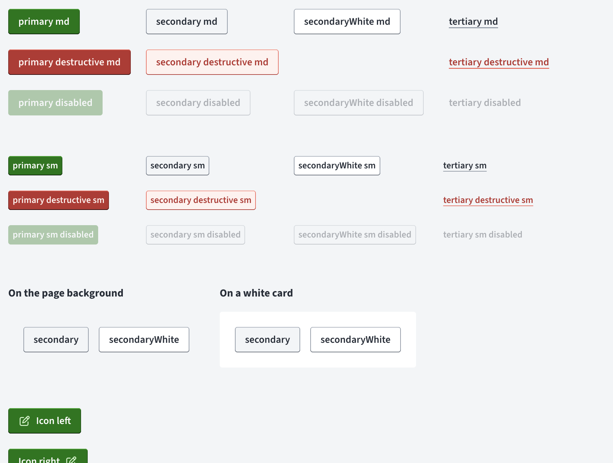
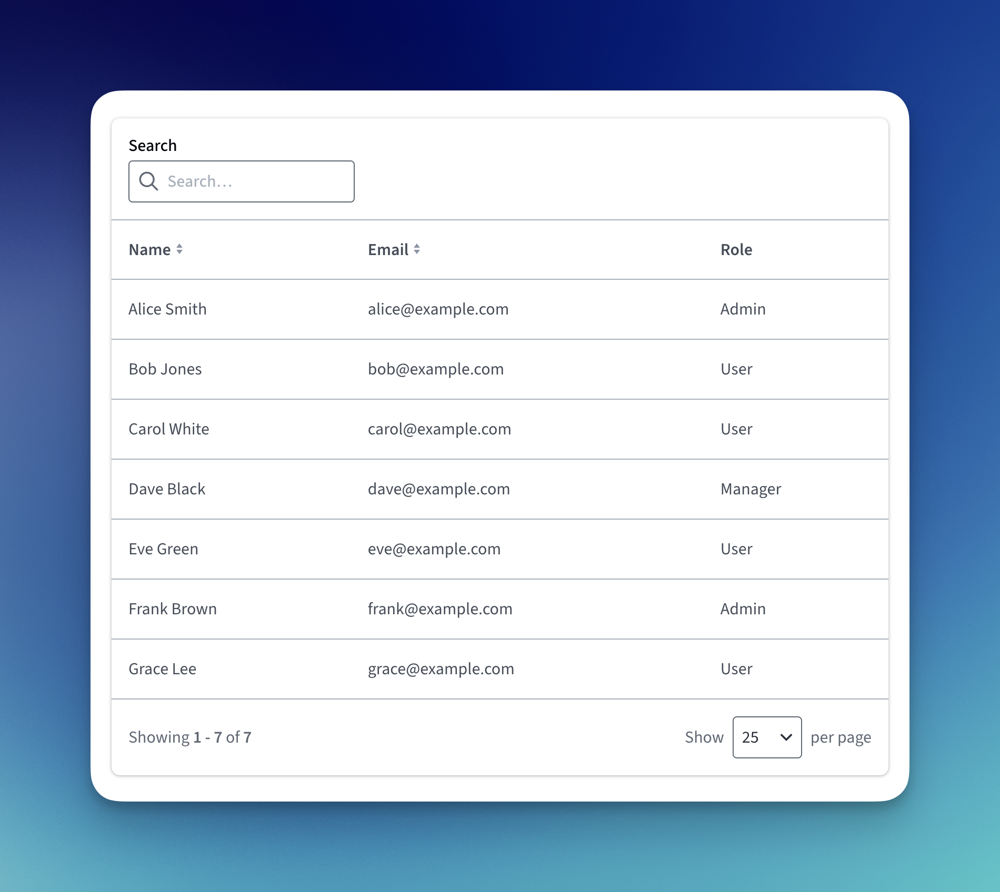
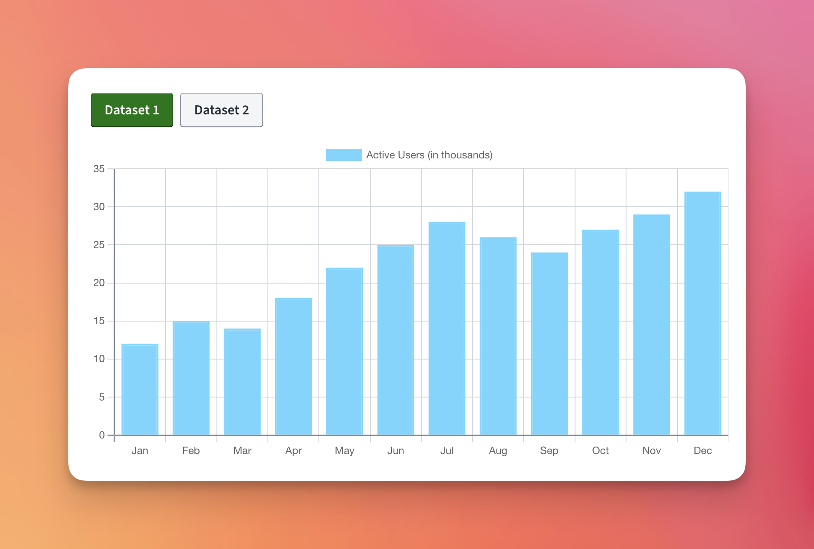
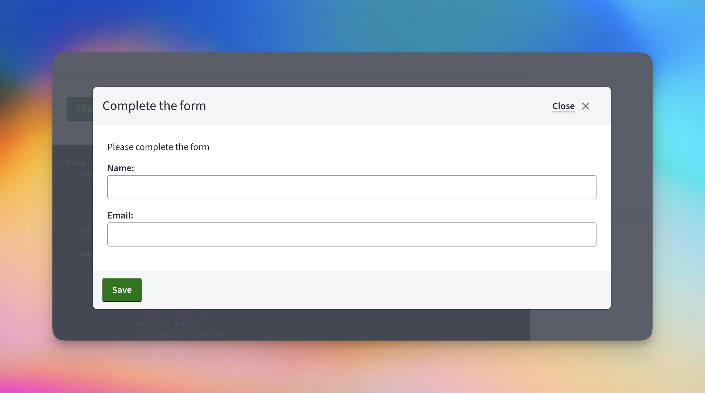

## Why we needed a design system

The UI was fragmented. The same button, input or dialog had been rebuilt over and over across the app, each copy with its own markup and its own classes. Nothing tied them together, so changing anything meant finding every copy.

Accessibility is where this hurt most. Fixing how one button behaved for keyboard or screen reader users could mean editing hundreds of files across every part of the app. A fix that small should take one change in one place.

## Foundations

We didn't start from nothing. Design came with tokens in Figma and an outline for each component. What didn't exist yet was everything in between: how those designs would become working front-end code, and how the rest of the team would find and use them. That part was mine, including the stack, the architecture and [Storybook](https://storybook.js.org) for documentation.

### From Figma tokens to Tailwind utilities

The first job was getting design's tokens into the codebase in a form that couldn't drift. I translated the Figma tokens into CSS variables, then exposed those variables through custom Tailwind utilities.

The utilities are named after what they mean, not what they look like. A button doesn't get a green background class. It gets `button-background-primary-default`, plus a matching utility for hover, focus, pressed and disabled. The colour lives in a single CSS variable, so when design adjusts a token, every component using it picks up the change, and nobody has to search the app for hex values.

### Behaviour from a library, styling from us

For behaviour, we used [PrimeVue](https://primevue.org) in unstyled mode. It handled the fiddly parts that are easy to get wrong, like focus management, keyboard interaction and ARIA attributes, and left all the styling to us.

On top of that I built our own theming API with [cva](https://cva.style) and [tailwind-merge](https://github.com/dcastil/tailwind-merge). cva describes each component as a set of variants, and twMerge means consumers can still pass in their own classes without fighting the defaults. PrimeVue's passthrough API was then mapped onto ours, so nothing outside the design system ever talks to PrimeVue directly.

That last part was deliberate. Wrapping a library behind your own API costs a bit more upfront, but the library becomes an implementation detail. If we ever needed to swap PrimeVue out, each component's public API could stay the same and the rest of the app wouldn't need to know.

<!-- TODO: why PrimeVue over other options at the time? -->

### Anatomy of a button



The button shows how the pieces fit together. Each component is split into three parts: the component itself, which owns markup and behaviour; a theme file holding the cva definitions; and a small composable with the shared props and the logic that resolves props into classes.

The theme file is where the design lives. There are variants for hierarchy (primary, secondary, secondaryWhite, tertiary), destructive versions of each, and an icon-only variant. Each variant is a list of token utilities, one per state:

```js
export const buttonTheme = cva('font-[600] flex justify-center items-center rounded-sm gap-2', {
    variants: {
        variant: {
            primary: `
                button-background-primary-default
                button-text-primary-default
                hover:button-background-primary-hover
                focus-visible:button-background-primary-focus
                active:button-background-primary-pressed
                disabled:button-background-primary-disabled
            `,
            // secondary, secondaryWhite, tertiary, destructive variants, iconOnly...
        },
        size: {
            md: 'py-[0.75rem] px-[1rem] text-[1rem] active:pt-[0.8125rem] active:pb-[0.6875rem]',
            sm: 'py-[0.5rem] px-[0.438rem] text-[0.91rem] active:pt-[0.5625rem] active:pb-[0.4375rem]'
        },
        disabled: {
            false: 'cursor-pointer',
            true: 'cursor-not-allowed pointer-events-none'
        }
    }
})
```

Read it from the design side and it maps straight onto the Figma file: every state design specified has a utility, and every utility points at a token. Size, disabled state and icon position are separate variant axes, so any combination comes from the same definition rather than from one-off classes. The `active:` padding on each size is a small detail. Pressing a button moves its label down by a pixel, so it feels like it's being pushed in.

Some variants exist only because of where buttons get used: `secondaryWhite` is there because a secondary button needs to look different on the grey page background than on a white card.

The component never assembles classes itself. It hands its props and any derived state to the composable, which resolves them into classes for each part of the button:

```js
const isDisabled = computed(() => props.disabled || props.loading)

const theme = useButtonTheme(props, () => ({
    disabled: isDisabled.value
}))
```

Then the template just reads `theme.root.class` and `theme.icon.class`. Styling decisions stay in the theme, and the component stays about markup and behaviour.

The component file is where most of the accessibility work lives, and it's exactly the work that used to be spread across hundreds of files:

```vue
<button
    :type="props.type"
    :disabled="isDisabled"
    :aria-label="props.ariaLabel"
    :aria-busy="props.loading ? 'true' : undefined"
    :class="theme.root.class"
>
    <i v-if="!!props.icon" aria-hidden="true" :class="[props.icon, theme.icon.class]" />
    <!-- label, then the spinner with <span class="sr-only">Loading</span> -->
</button>
```

- **Icons are decorative.** They're hidden from assistive technology, so a screen reader announces the label and not the icon.
- **Missing names get flagged.** If a button ends up with no accessible name, for example an icon-only button without an `aria-label`, `warnMissingAccessibleName` warns in development.
- **Loading is announced, not just shown.** A loading button is disabled straight away and marked `aria-busy`, and the spinner comes with visually hidden "Loading" text.
- **Motion is opt-in.** Every animation is behind `motion-safe`, so people who've asked their OS for reduced motion don't get any.

The loading state has a bit more polish too. The spinner doesn't appear until loading has lasted 250ms, and once it appears it stays for at least 250ms. Fast requests never flash a spinner, and slow ones never show one that flickers in and out. All of that timing lives in a small composable, so the button only has to ask whether the spinner should be visible:

```js
const { isVisible: isSpinnerVisible } = useDelayedLoading(() => props.loading)
```

When the spinner appears, the button grows to make room for it instead of jumping in width. The spinner sits in a one-column grid, and a Vue `<Transition>` animates that column from `0fr` to `1fr`:

```js
export const spinnerTransition = {
    enterActiveClass: 'motion-safe:transition-[grid-template-columns,margin,opacity] motion-safe:duration-200 ease-out',
    enterFromClass: 'grid-cols-[0fr] -ml-2 opacity-0',
    enterToClass: 'grid-cols-[1fr]',
    // leave classes mirror these
}
```

The `-ml-2` cancels the button's `gap-2` while the column is collapsed, so there's no stray gap before the spinner arrives. On an icon-only button there's nothing to grow next to, so the spinner takes the icon's place.

Every part of the button also has a stable `data-test` attribute, so tests don't depend on class names or markup that might change.

Not every component wraps PrimeVue. A button doesn't need a library to manage its behaviour, so it renders a native `<button>`. The architecture doesn't care: consumers only see our API, and each component can choose whatever implementation suits it.

## Shipping components alongside feature work

The hardest part of building a design system wasn't technical. It was finding the time.

I'm in a feature team. We work on what's on the board, and anything outside of that happens if there's time, which there usually isn't. Arguing for a generic, reusable component is a hard sell when there's a deadline on the feature that needs it. Building the reusable version properly will always take longer than building the one thing the feature needs, and on a tight schedule the feature wins.

So instead of asking for time we didn't have, I talked it through with my managers and our product lead, and we agreed on a different approach: parallel delivery.

The idea was simple. Say a feature needed a button. I'd build the feature with a button that did exactly what it needed and nothing more, and ship it. At the same time, I'd work on the generic, reusable button alongside it. Once that was ready, it would replace the one-off in the feature. Rather than putting 100% of my effort into either the feature or the system, I'd split it roughly 50/50.

<!-- TODO: a real example end to end. Which feature, which component, how long until the swap, and who did it? -->
<!-- TODO: what convinced your managers and product lead? Was there any pushback, and did features ever slow down? -->

It meant features never waited on the design system, and the design system never had to justify itself against the roadmap. It grew one component at a time, each one pulled into existence by a real feature that needed it, which also meant every component was tested against a real use case from day one.

## What we've built

To date the library includes:

- **Actions and display**: Button, Tag (Pill), Avatar, AvatarGroup, Skeleton, Text
- **Forms**: InputText, InputNumber, Checkbox, RadioGroup, Select (ListBox and Combobox), and a `useForm` composable
- **Layout and overlays**: Dialog, Panel, Accordion, Tabs
- **Data**: Table and Chart

Most of them are straightforward once the foundations are in place. A few needed more thought.

### Table



The Table is built on [TanStack Table](https://tanstack.com/table) rather than PrimeVue's DataTable. Search, sorting and pagination all come built in, so a new table in the app is mostly a matter of defining columns and passing data.

<!-- TODO: why TanStack instead of PrimeVue's DataTable? Anything tricky about it, e.g. server-side pagination? -->

### Chart



<!-- TODO: what powers the Chart (Chart.js?), and what does the component give you over using the library directly? -->

The Chart is also a good example of the system composing with itself: the dataset switcher is just our Button component.

### Dialog and useForm



<!-- TODO: what does useForm handle (validation, errors, submission state)? How do Dialog actions work, e.g. label, action and loading? -->

## Designers in the codebase

As the library grew, it started to change who could build features. Because so much of the complexity lives inside the components (states, accessibility, layout and validation), backend engineers and designers could start working on features with confidence. They didn't need to know how a combobox manages focus or how a table paginates. They needed to know which component to reach for, and Storybook is where they find out.

Designers now open PRs themselves. At the moment most of them swap old, hand-rolled HTML for design system components, the same fragmented UI that started all this. Each of those PRs removes one more copy that someone would otherwise have had to find and fix by hand.

## What's next

<!-- TODO: status of the Reka UI migration (not started, in progress, done?) and whether the abstraction has held up so far. -->

PrimeVue is moving towards a premium model, so we're moving the components to [Reka UI](https://reka-ui.com). This is where the early architecture decision gets tested. Because the rest of the app only ever talks to our API, never to PrimeVue directly, the migration should stay inside the design system. That was the whole point of the wrapper.

There are more components to come as well, and like the rest, they'll arrive when a feature needs them.

<!-- TODO: anything you'd do differently? -->
