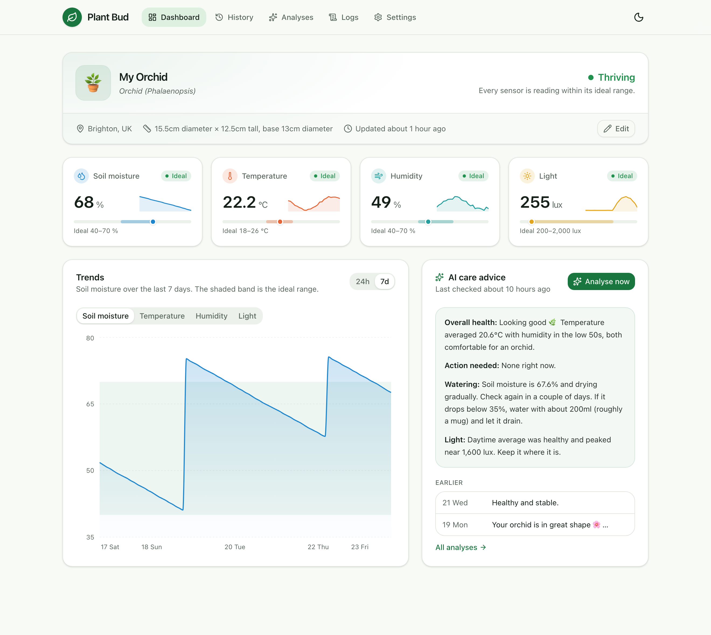
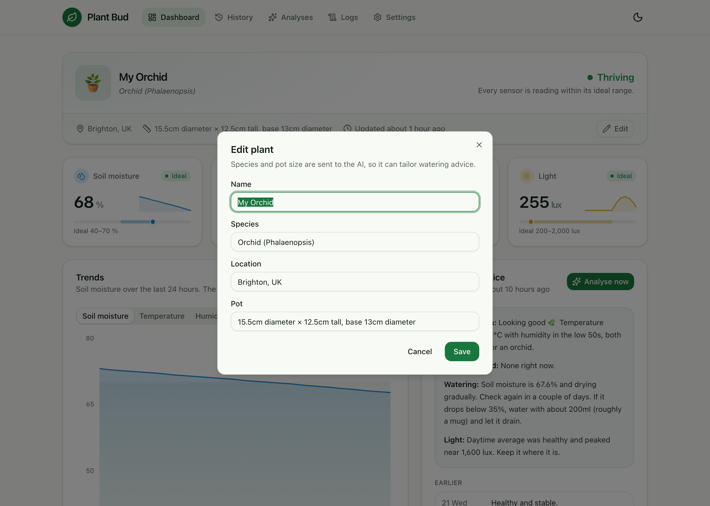
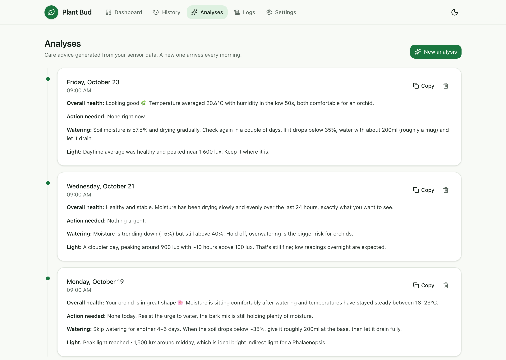
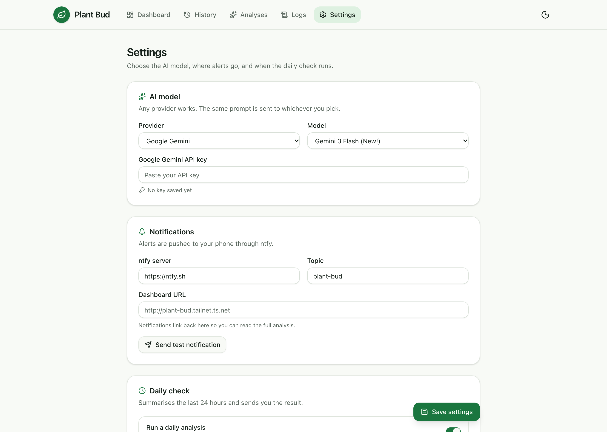
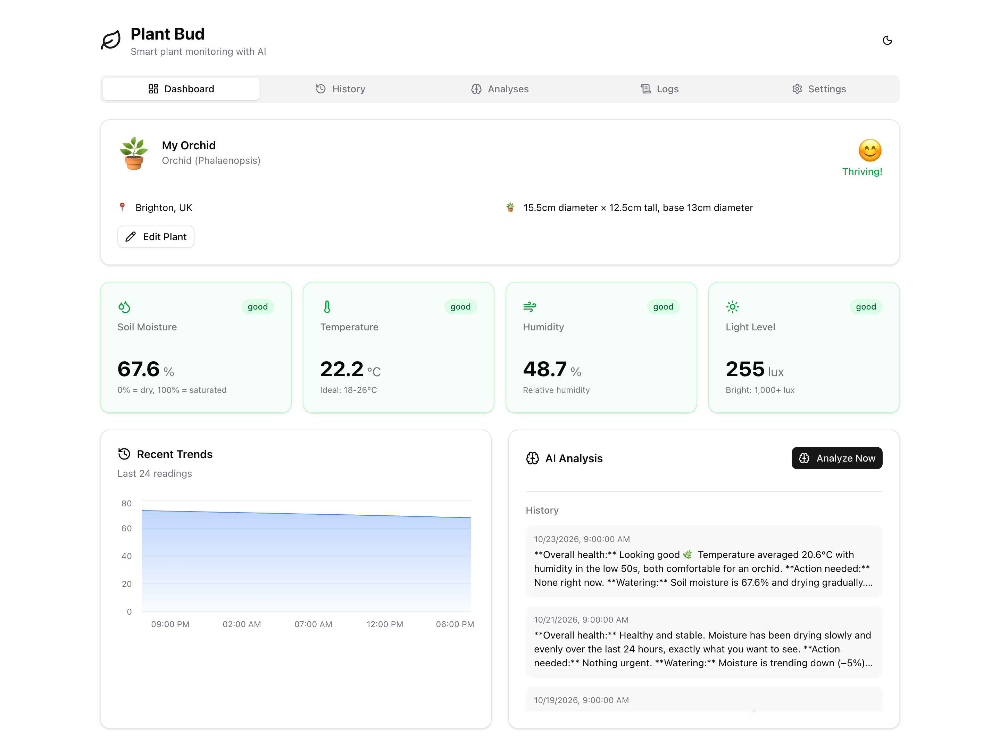
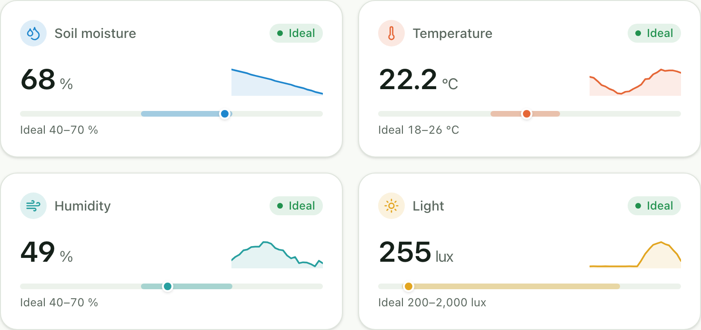
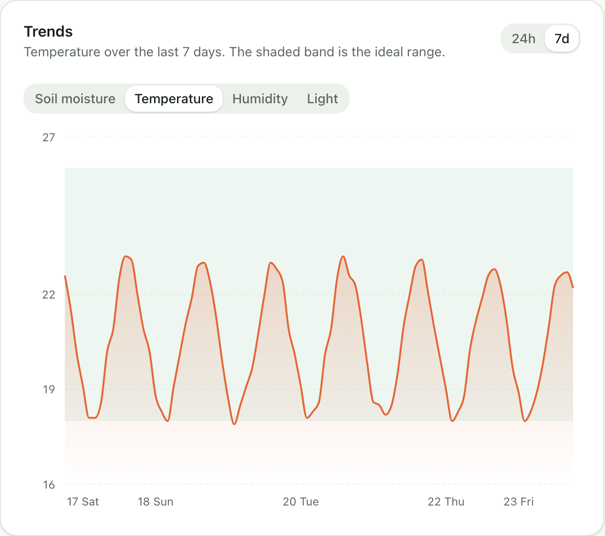
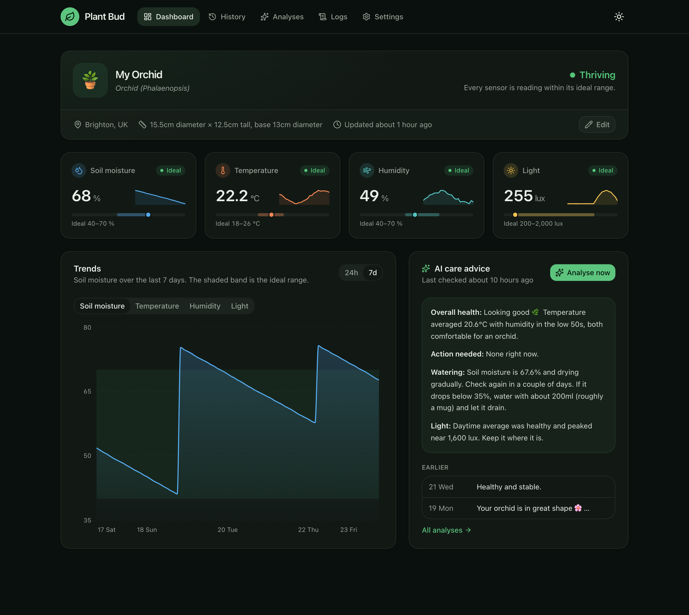
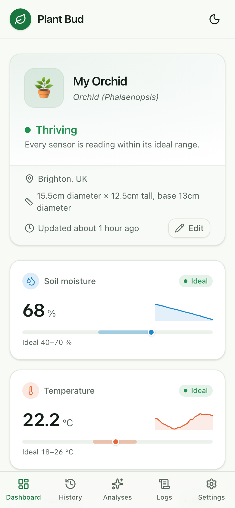

## Why I built it

I have an orchid, and I overwater it. Phalaenopsis orchids want their roots to dry out between waterings, which is exactly the opposite of my instinct when a plant looks a bit sad.

I didn't want another app that sends a reminder every Sunday whether the plant needs water or not. I wanted something that could look at what was actually happening in the pot, and only bother me when there was a reason to.

So I built Plant Bud in my own time: a small sensor in the pot, a server that stores the readings, and an AI model that reads the last 24 hours each morning and tells me, in plain English, whether to do anything. I built it with [Gemini](https://gemini.google.com), which also powers the plant analysis by default.

<!-- TODO: how did you use Gemini while building it? Pair-programming in an editor, generating the first pass of each piece, debugging the hardware? -->
<!-- TODO: did the raw-readings approach give vague advice or flag low light at night? If so, that's a good story for the "right context" section below. -->

## How it fits together

There are four parts, and each one has one job:

1. **The sensor node** wakes up once an hour, reads the soil, air and light, posts the reading to the server and goes back to sleep.
2. **The server** stores readings, runs the daily analysis and serves the dashboard.
3. **The AI model** turns a day of numbers into a short, specific piece of advice.
4. **[ntfy](https://ntfy.sh)** pushes that advice to my phone, with a link back to the full analysis.

The server is [Bun](https://bun.sh) with [Hono](https://hono.dev) and SQLite through [Drizzle](https://orm.drizzle.team). The dashboard is React with Tailwind, [shadcn/ui](https://ui.shadcn.com) and Recharts, built into static files the same server hosts. It was first set up on a Raspberry Pi Zero 2 W and now runs in Docker on a small VPS.

## The hardware

The sensor node is a Seeed XIAO ESP32-C3 with three sensors wired to it:

- A **capacitive soil moisture sensor**. Capacitive rather than resistive, because resistive probes corrode quickly in wet soil.
- A **DHT22** for air temperature and humidity.
- A **BH1750** for light, in lux.

<!-- TODO: a photo of the sensor in the pot would be great here -->

The interesting constraint is power. The node only needs to report once an hour, so it spends nearly all its time in deep sleep with Wi-Fi off. Each wake-up runs top to bottom through `setup()` and never reaches `loop()`:

```cpp
void setup() {
  connectWiFi();

  float soilMoisture = readSoilMoisture();
  float temperature = dht.readTemperature();
  float humidity = dht.readHumidity();
  float light = lightMeter.readLightLevel();

  sendData(soilMoisture, temperature, humidity, light);

  WiFi.disconnect(true);
  WiFi.mode(WIFI_OFF);
  goToSleep(); // wakes up an hour later and starts from setup() again
}
```

### Calibrating the soil sensor

A capacitive moisture sensor doesn't output a percentage. It outputs a raw analogue reading that goes *down* as the soil gets wetter, and the range differs from sensor to sensor.

So the firmware has a calibration mode. Flip a flag, and instead of sleeping it prints an averaged ADC reading every two seconds for five minutes. I held the sensor in the air for the dry value, put it in a glass of water for the wet one, and the firmware maps everything in between to 0–100%. Mine came out at 3723 dry and 1287 wet.

## Giving the AI the right context

The simplest approach is to send the model a pile of raw readings and ask for advice. The on-demand "Analyse now" button still does a version of that, sending the last 48 readings with averages and a moisture trend.

For the daily check I wanted to do more of the maths in code and give the model a summary instead. Each morning the server turns the last 24 hours into a daily aggregate, with each sensor summarised in the way that matters for that sensor:

```ts
export interface DailyAggregate {
  // Latest value plus trend: what matters for deciding whether to water
  moisture: { latest: number; min: number; max: number; trend: 'drying' | 'stable' | 'wetter'; trendPercent: number }
  // Full range: plants care about extremes, not averages
  temperature: { avg: number; min: number; max: number }
  humidity: { avg: number; min: number; max: number }
  // Peak and hours of daylight, instead of a 24 hour average that includes the night
  light: { peak: number; daylightHours: number; daytimeAvg: number }
}
```

An average light level across 24 hours is meaningless when half of those hours are dark. Peak lux and hours above 100 lux describe the plant's day much better.

The rest of the prompt is context a plant expert would ask for before giving advice: the species, the pot size, that it's in Brighton, the time of day, and one line that turned out to matter a lot:

> Watering: The user tends to overwater. If watering is needed, provide specific volume suggestions based on pot size.



That's why the species and pot fields exist. "Water it" isn't useful advice. "Give it about 200ml, roughly a mug, and let it drain" is.

### The code decides what's urgent

I didn't want the model deciding when to wake me up. Language models like to sound helpful, and helpful often reads as alarming.

So urgency is plain code. Soil below 20% or temperature outside 10–35°C is urgent. Those notifications go out at high priority with a warning tag, and everything else is a routine update. The prompt backs this up by banning words like "Urgent" or "Warning" unless the same thresholds are crossed, so the tone of the message matches its priority.

The model replies in two parts separated by `---`: a one-sentence notification and a longer analysis. The notification becomes the push message, and its action button opens the full analysis in the dashboard.



## When the AI is down

A daily job that calls an external API will eventually hit a bad day. Overloaded models return 503s, and rate limits return 429s.

Every call goes through a small retry helper. Errors that are worth retrying get exponential backoff (one second, then two), and anything else, like a bad API key, fails straight away. If all the quick retries fail, the analysis goes into a background queue that tries again every 30 minutes. When it finally succeeds, a callback saves the analysis and sends the notification as if nothing had happened.

From my side, a rough morning for the AI provider just means the notification arrives a little later.

## Any model, same prompt



Gemini is the default, but the analysis isn't tied to it. The same prompt can go to OpenAI, Anthropic or anything on OpenRouter, picked from a dropdown in settings. Each provider is a small function that takes a prompt and returns text, and everything around it (retries, parsing, saving, notifying) is shared.

It means trying a different model on the same data, or replacing one that's been deprecated, is a settings change rather than a code change.

## Keeping it private

The dashboard can delete data and holds API keys, so it isn't on the public internet at all. It's only reachable over [Tailscale](https://tailscale.com), from my own devices.

The sensor is the one thing that has to reach the server from outside. [Caddy](https://caddyserver.com) exposes a single public port that only accepts one request, a `POST` to the readings endpoint, and everything else gets a 403:

```caddy
:8080 {
    @esp32 {
        method POST
        path /api/readings
    }
    handle @esp32 {
        reverse_proxy plant-bud:3000
    }
    handle {
        respond "Forbidden" 403
    }
}
```

On top of that, the server checks a shared API key header on every reading, so knowing the address isn't enough to post fake data.

## Revisiting the dashboard

The first dashboard did the job, but it was plainly a first pass: stock shadcn styles, a chart that tried to plot four sensors with different units on one axis, and AI advice shown as raw markdown, asterisks and all.



<!-- TODO: say which tools you used for this pass, if you want to mention it -->

Coming back to it, I wanted it to answer one question at a glance: *is the plant OK?*

- **A status with a reason.** The plant card says "Thriving", "Keep an eye on it" or "Needs attention", and underneath it explains why, for example "Soil moisture: drying out".
- **Sensor cards with context.** Each card shows where the reading sits against the plant's ideal range, plus a sparkline of the last 24 hours, so a number like "68%" actually means something.
- **One chart, one sensor at a time.** Soil moisture, temperature, humidity and light have different units, so the chart shows one at a time against its ideal band, over 24 hours or 7 days. Watering events show up as clear spikes.
- **Light at night is fine.** Low light between 9pm and 7am no longer gets flagged, the same rule the AI follows.





It also has a proper dark mode, and on a phone the navigation moves to a bottom tab bar.





The same pass fixed a few things that only show up with real use. Saving settings used to send the masked API keys back to the server, quietly replacing the real key with `...abcd`. The public port was also accepting any method on the readings path rather than only `POST`.

*Screenshots use a week of generated demo readings, so the charts and advice are illustrative.*

## What's next

After a while I stopped using it. Not because it didn't work, but because it did its job: a few weeks of readings and advice taught me what the orchid actually needs, and I no longer needed a sensor to tell me.

So the next plan is to try it with a plant that's harder to look after, and see how it goes.

That needs a couple of changes. Right now each sensor node has its plant ID hard-coded as `plant-1`, and the dashboard shows a single plant. The next step is more plants:

- **Plant IDs from the chip's MAC address**, so the same firmware can be flashed to every node, and new plants register themselves on their first reading.
- **Over-the-air updates despite deep sleep.** A node that's asleep 99% of the time can't receive an update, so the plan is a maintenance mode: the server replies to a reading with `stayAwake: true`, and the node keeps Wi-Fi on for ten minutes so I can flash it wirelessly.
- **Room-level light tracking**, so the AI can suggest moving a plant somewhere brighter.

<!-- TODO: name the harder plant once you've picked it, e.g. a calathea or a fiddle-leaf fig -->
